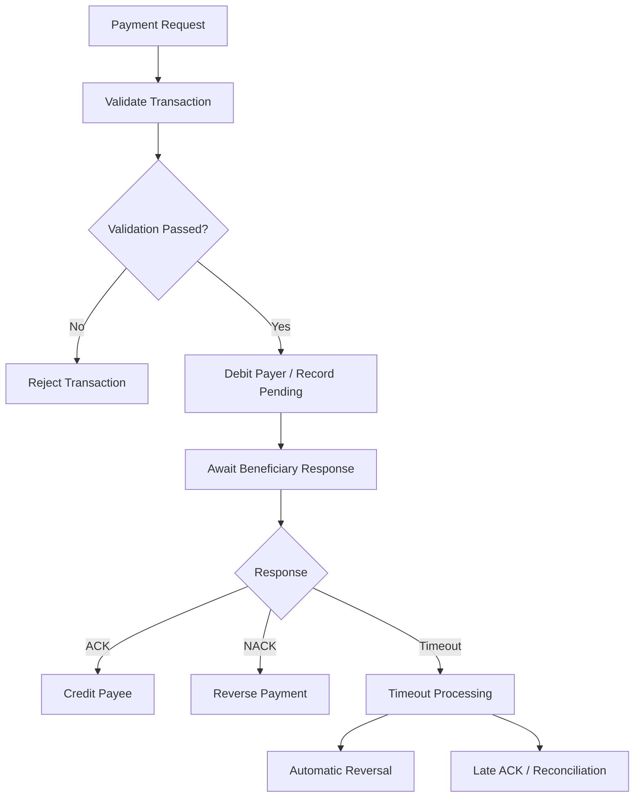

# 10Sec — UPI Payment Switch

<p align="center">
  <strong>A Java-based UPI Payment Switch implementing payment processing, transaction limits, reversals, refunds, and chargeback workflows.</strong>
</p>

<p align="center">
  
  
  
  
  
</p>

## Overview

**10Sec** is a backend implementation of a UPI Payment Switch developed for **PS-006: UPI Payment Switch with Limits, Reversals and Chargebacks**.

The project simulates important backend responsibilities involved in processing UPI transactions, including payment authorization, transaction validation, beneficiary responses, timeout handling, ledger accounting, refunds, and dispute management.

The objective is to demonstrate how a payment switch can coordinate transaction processing while enforcing financial and operational business rules.

## Key Features

### 1. Payment Processing
- Person-to-person (P2P) payments.
- Person-to-merchant (P2M) payments.
- Payment authorization and validation.
- Beneficiary ACK and NACK response handling.
- Transaction state management.
- Idempotency-oriented transaction handling.

### 2. Transaction Limits and Risk Controls
- Per-transaction monetary limits.
- Different limits for verified and unverified merchants.
- Daily transaction monetary limits.
- Daily debit velocity limits.
- New VPA cooling-period restrictions.
- New beneficiary cooling-period restrictions.

### 3. Collect Requests
- UPI Collect request processing.
- Collect approval and decline workflows.
- PIN requirement threshold handling.
- Request expiry management.
- Maximum expiry window enforcement.

### 4. Reversals and Timeout Management
- Pending transaction timeout processing.
- Automatic reversal handling.
- Beneficiary response processing.
- Late ACK and deemed-success handling.
- Reconciliation shortfall handling.

### 5. Ledger and Financial Reconciliation
- Double-entry-oriented ledger architecture.
- Debit and credit ledger entries.
- Account balance tracking.
- Transaction-level financial reconciliation.
- Participant opening and closing balance verification.
- Handling of in-flight transactions.

### 6. Refunds and Dispute Management
- Refund processing.
- Transaction dispute creation.
- Chargeback lifecycle management.
- Representment workflows.
- Pre-arbitration handling.
- Dispute closure.
- TCC and chargeback deadline handling.
- Business-day calculations with holiday support.

### 7. Reporting
The project generates CSV reports for transaction processing and reconciliation:

| Report | Description |
|---|---|
| `txn_log.csv` | Transaction processing history |
| `txn_final.csv` | Final transaction statuses |
| `dispute_log.csv` | Dispute lifecycle events |
| `statements.csv` | Account statements and running balances |

## Technology Stack

| Component | Technology |
|---|---|
| Language | Java 17 |
| Backend Framework | Spring Boot 3.2.3 |
| Build Tool | Maven |
| Database | PostgreSQL |
| Persistence | Spring Data JPA |
| ORM | Hibernate |
| Database Migrations | Flyway |
| Testing | JUnit 5, Mockito |
| Container-based Testing | Testcontainers |

## Architecture

The application is organized into domain-oriented packages.

```text
src/
├── main/
│   ├── java/
│   │   └── com/ps006/upiswitch/
│   │       ├── account/
│   │       ├── payment/
│   │       ├── ledger/
│   │       ├── dispute/
│   │       ├── refund/
│   │       ├── collect/
│   │       ├── command/
│   │       └── common/
│   │
│   └── resources/
│       ├── application.properties
│       └── db/
│           └── migration/
│
└── test/
    └── java/
        └── com/ps006/upiswitch/
```

The major functional areas include:

- **Payment:** Payment processing, validation and beneficiary responses.
- **Account:** Participant account and balance management.
- **Ledger:** Financial postings and reconciliation.
- **Collect:** Collect request lifecycle.
- **Refund:** Refund processing.
- **Dispute:** Chargebacks, representment and dispute state transitions.
- **Command:** Command parsing and sample dataset execution.
- **Common:** Shared entities, repositories, configuration and utilities.

## Payment Lifecycle

A simplified payment lifecycle:



## Business Rules

The implementation includes the following important limits and controls from the PS-006 specification.

| Rule | Limit / Behaviour |
|---|---|
| P2P per-transaction limit | ₹1,00,000 |
| Verified merchant P2M limit | ₹2,00,000 |
| Unverified merchant P2M limit | ₹1,00,000 |
| Daily debit velocity | Maximum 20 debits |
| New VPA cooling period | 24 hours |
| New beneficiary cooling period | 24 hours |
| New VPA / beneficiary initial cap | ₹5,000 |
| Collect PIN threshold | Amounts above ₹2,000 require PIN flag |
| Standard Collect expiry | 30 minutes |
| Maximum Collect expiry | 72 hours |
| TCC window | T+5 calendar days |
| Chargeback window | T+45 calendar days |
| Representment | 5 working days, excluding configured holidays |

Refer to the supplied sample specification for the complete business-rule definitions and scenarios.

## Getting Started

### Prerequisites

Install the following:

- Java Development Kit (JDK) 17.
- Apache Maven.
- PostgreSQL.
- Git.

Verify your installations:

```bash
java -version
mvn -version
psql --version
```

### 1. Clone the Repository

```bash
git clone https://github.com/VAIRAGYASINGH/Team-T046-PS-006.git
cd 10Sec
```


### 2. Configure PostgreSQL

Create a PostgreSQL database:

```sql
CREATE DATABASE upi_switch;
```

Configure the database connection in:

```text
src/main/resources/application.properties
```

Use your own local PostgreSQL credentials. For example:

```properties
spring.datasource.url=jdbc:postgresql://localhost:5432/upi_switch
spring.datasource.username=${DB_USERNAME}
spring.datasource.password=${DB_PASSWORD}
```

Make sure the remaining Spring Boot and Flyway configuration in the project is preserved.

Do not commit real database passwords or credentials.

### 3. Run Database Migrations

The application uses Flyway to manage database schema migrations.

The migration scripts are located under:

```text
src/main/resources/db/migration/
```

The application is configured to run Flyway migrations during startup.

### 4. Build the Project

```bash
mvn clean compile
```

### 5. Run the Application

```bash
mvn spring-boot:run
```

Use the configuration and command-processing setup included in the repository to execute the sample scenarios.

## Sample Dataset

The repository includes a sample dataset under:

```text
sample-data/
└── T046-PS-006-sample-data/
    ├── README.md
    ├── commands.txt
    └── holidays.csv
```

The dataset contains scenarios covering:

- P2P and P2M payments.
- Transaction limit validation.
- Cooling periods.
- Velocity restrictions.
- Collect requests.
- Beneficiary ACK and NACK responses.
- Timeout and reversal scenarios.
- Refunds.
- Chargebacks.
- Representment and pre-arbitration.
- Holiday-aware deadlines.
- Account statements.

Read the dataset's `README.md` before executing its commands.

## Running Tests

Run the complete test suite:

```bash
mvn test
```

Run individual test classes:

```bash
mvn test -Dtest=SampleDatasetPayScenarioTest
mvn test -Dtest=FinancialReconciliationAuditTest
mvn test -Dtest=DisputeEngineComprehensiveTest
```

Some live PostgreSQL migration tests use Testcontainers and require Docker.

Without a running Docker daemon, those tests are configured to skip.

**Testing note:** The final development verification identified remaining test-harness, assertion and environment-related issues. The core sample scenarios and targeted financial reconciliation and dispute tests were verified independently. See the `docs/` directory for the verification reports.

## Known Limitations

- The project is an academic and engineering demonstration, not a production-certified UPI switch.
- Actual NPCI connectivity, bank integrations, PSP integrations and live UPI network communication are not included.
- The current pending transaction scenario `TXN-0038` retains a ₹4,200 in-flight debit without a beneficiary credit. This is represented as an escrow hold in participant reconciliation; the global ledger double-entry invariant is therefore not fully balanced for that pending transaction.
- Docker-dependent live migration tests require Docker to execute.
- Production deployment would require additional security, operational monitoring, integration testing and regulatory validation.

## Project Verification

The final remediation and verification process covered:

- Payment processing and transaction validation.
- Collect approval and decline workflows.
- Timeout and reversal processing.
- Refund and chargeback scenarios.
- Holiday-aware dispute deadlines.
- Financial reconciliation.
- Participant balance verification.
- CSV report generation.

Development and remediation reports are available in the `docs/` directory.

## Repository Structure

```text
10Sec/
├── src/
│   ├── main/
│   └── test/
├── sample-data/
│   └── T046-PS-006-sample-data/
├── docs/
├── output/
├── pom.xml
├── mvnw
├── .gitignore
└── README.md
```

The exact repository contents may vary by release.

## Contributing

Contributions, bug reports and suggestions are welcome.

1. Fork the repository.
2. Create a feature branch.
3. Implement your changes.
4. Add or update tests.
5. Submit a pull request describing the changes.

Please avoid committing credentials, private data or local database files.

## License

This project is currently published without an explicit open-source license.

If you intend to allow others to reuse, modify and distribute it, add a license file (for example, MIT) after choosing the license terms.

## Author

**UPI Payment Switch**

Developed as an implementation of PS-006: UPI Payment Switch with Limits, Reversals and Chargebacks.

If you find this project useful, consider starring the repository ⭐.

---

**Disclaimer:** This project is an independent educational implementation. It is not affiliated with, endorsed by, or connected to NPCI, UPI, or any participating bank.
